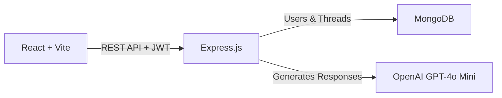

<div align="center">

# SigmaGPT

**A ChatGPT-inspired AI assistant with accounts, chat memory, PDF Q&A, and light/dark themes.**

<br />

### Built with

<p>
  
  
  
  
</p>

<p>
  
  
  
  
</p>

<p>
  
  
  
  
</p>

<p>
  
  
  
  
</p>

<br />

**[Features](#features) · [Screenshots](#screenshots) · [Setup](#getting-started) · [API](#api-endpoints) · [Deployment](#deployment)**

</div>


## Features

- AI-powered conversations using GPT-4o Mini
- Email + password authentication (JWT), with hashed passwords
- Private chat history - every thread belongs to the account that created it
- Context-aware replies - the last 20 messages of a thread are replayed to the model, so the conversation actually remembers itself
- PDF upload and AI Q&A - attach a PDF and ask questions about its contents
- Light / dark / system theming
- Settings panel - theme, display name, and password change
- Persistent conversation history
- Automatic thread management
- Recent chats sidebar with search and a drag-to-resize divider
- Typing animation and auto-scroll
- Inline error messages when a request fails
- Responsive interface
- Modern ChatGPT-inspired UI
- MongoDB database integration

## Architecture



## API Endpoints

### Auth (public)

| Method | Endpoint | Description |
| --- | --- | --- |
| POST | `/api/auth/signup` | Create an account with `{ name?, email, password }` |
| POST | `/api/auth/login` | Log in with `{ email, password }`, returns a JWT |

### Auth (token required)

| Method | Endpoint | Description |
| --- | --- | --- |
| GET | `/api/auth/me` | Return the logged in user |
| PATCH | `/api/auth/me` | Update the display name |
| PATCH | `/api/auth/me/password` | Change the password (needs the current one) |

### Chat (token required)

All chat routes need an `Authorization: Bearer <token>` header.

| Method | Endpoint | Description |
| --- | --- | --- |
| POST | `/api/chat` | Generate an AI response for `{ threadId, message }` |
| GET | `/api/thread` | Fetch the logged in user's conversations |
| GET | `/api/thread/:threadId` | Fetch one conversation |
| DELETE | `/api/thread/:threadId` | Delete a conversation |
| POST | `/api/thread/:threadId/document` | Attach a PDF (multipart field `file`) |
| DELETE | `/api/thread/:threadId/document/:documentId` | Remove an attached PDF |

## PDF upload & AI Q&A

Attach a PDF with the paperclip in the message box. On upload the server extracts the
text with `pdf-parse`, stores it on the thread, and replays it to the model as a system
message on every later question in that chat - so you can keep asking follow-ups.

| Limit | Value |
| --- | --- |
| File type | PDF only |
| File size | 10 MB |
| PDFs per chat | 3 |
| Text kept per PDF | 12,000 characters (longer files are truncated) |

The PDF itself is never stored - only the extracted text. Scanned/image-only PDFs are
rejected with a clear message, since they have no text layer to read.

## Theming

Light, dark, and system, chosen in **Settings → General** and remembered in
`localStorage`. Picking *System* keeps following your OS appearance while the app is
open. The palette lives entirely in CSS variables in `Frontend/src/index.css`, so
changing a colour in one place changes it everywhere.

## Settings

Open it from the avatar menu in the top right.

- **General** - theme, and the PDF attachment limits
- **Account** - your email (read-only) and display name
- **Security** - change your password; the current one must be entered, the new one has
  to satisfy the rules below, and a fresh token is issued so the session survives

## Password rules

A new password must contain at least:

- 8 characters
- one lowercase letter
- one uppercase letter
- one number
- one special character

The rules are enforced on the server and shown live while typing on the sign up form.
Passwords are hashed with bcrypt before they are stored and are never returned by the API.

## Tech Stack

### Frontend


Context API for state, `react-markdown` + `highlight.js` for rendering replies,
Font Awesome for icons, and CSS variables for theming.

### Backend


Express 5 REST API, Mongoose models, JWT auth with bcrypt-hashed passwords,
Multer for uploads, and `pdf-parse` for text extraction.

### AI


## Screenshots

### Sign in

Email + password accounts. Passwords are hashed with bcrypt and never leave the server.


### Chat with memory

The last 20 messages of a thread are replayed to the model, so follow-up questions work.
Markdown and syntax highlighting are rendered inline.


### PDF upload & Q&A

Attach a PDF and ask about it. The attachment stays bound to the chat, so every later
question still sees it.


### Settings

Theme, display name, and password change - all in one panel.


### Light theme

The whole palette is CSS variables, so light and dark share one set of styles.


### Responsive

On phones the sidebar becomes a drawer over the chat instead of squeezing it.


## Project Structure

```
SigMA/
│
├── backend/
│   ├── middleware/
│   │   └── auth.js
│   ├── models/
│   │   ├── Thread.js
│   │   └── User.js
│   ├── routes/
│   │   ├── auth.js
│   │   └── chat.js
│   ├── utils/
│   │   ├── openai.js
│   │   └── pdf.js
│   ├── server.js
│   └── .env.example
│
├── Frontend/
│   ├── src/
│   │   ├── api.js
│   │   ├── App.jsx
│   │   ├── Auth.jsx
│   │   ├── Chat.jsx
│   │   ├── ChatWindow.jsx
│   │   ├── MyContext.jsx
│   │   ├── Settings.jsx
│   │   ├── Sidebar.jsx
│   │   ├── useSidebarWidth.js
│   │   └── useTheme.js
│   ├── public/
│   ├── .env.example
│   └── package.json
│
└── README.md
```

## Getting started

Everything below runs entirely on your own machine. You need your own OpenAI API key -
there is no shared key in this repository.

### Prerequisites

| Requirement | Notes |
| --- | --- |
| [Node.js](https://nodejs.org) 18+ | `node -v` to check |
| [MongoDB](https://www.mongodb.com/try/download/community) | a local install, or a free [Atlas](https://www.mongodb.com/atlas) cluster |
| An [OpenAI API key](https://platform.openai.com/api-keys) | the account needs credit for chat to work |

### 1. Clone and enter the project

```bash
git clone https://github.com/<your-github-username>/SigmaGPT.git
cd SigmaGPT/SigMA
```

### 2. Start MongoDB

**Option A - local MongoDB (recommended for development)**

macOS with Homebrew:

```bash
brew tap mongodb/brew && brew install mongodb-community && brew services start mongodb-community
```

Ubuntu/Debian:

```bash
sudo systemctl start mongod
```

Windows: MongoDB installs as a service and starts automatically. Otherwise run `net start MongoDB` in an admin terminal.

Check that it is listening on port 27017:

```bash
mongosh --eval "db.runCommand({ ping: 1 })"
```

**Option B - MongoDB Atlas**

Create a free cluster, add your IP under *Network Access*, then copy the connection
string. You will paste it into `MongoDbURI` in the next step.

### 3. Configure and run the backend

```bash
cd backend
npm install
cp .env.example .env
```

Open `backend/.env` and fill it in:

```env
OPENAI_API_KEY=sk-your-key-here
OPENAI_MODEL=gpt-4o-mini

# local MongoDB, or paste your Atlas connection string here
MongoDbURI=mongodb://127.0.0.1:27017/sigmagpt

# any long random string - see the command below
JWT_SECRET=paste_a_long_random_string_here
JWT_EXPIRES_IN=7d

PORT=8080
```

Generate a strong `JWT_SECRET`:

```bash
node -e "console.log(require('crypto').randomBytes(32).toString('hex'))"
```

Start the server:

```bash
npm run dev
```

You should see:

```
Connected with database
SigmaGPT server running on http://localhost:8080
```

If it exits instead, the message tells you why - a missing `JWT_SECRET`, or MongoDB not running.

### 4. Configure and run the frontend

In a **second terminal**, from the `SigMA` folder:

```bash
cd Frontend
npm install
cp .env.example .env
npm run dev
```

`Frontend/.env` only needs the backend URL, and the default already points at it:

```env
VITE_API_URL=http://localhost:8080
```

### 5. Open the app

Go to **http://localhost:5173**, click **Create one**, and sign up with any email and a
password that meets the rules below. Your account and chats live in your own database.

> Keep both terminals running. The frontend on `:5173` talks to the backend on `:8080`.

### Useful commands

| Where | Command | What it does |
| --- | --- | --- |
| `backend` | `npm run dev` | Start the API with auto-reload |
| `backend` | `npm start` | Start the API once (used in production) |
| `Frontend` | `npm run dev` | Start Vite on `:5173` |
| `Frontend` | `npm run build` | Production build into `dist/` |
| `Frontend` | `npm run lint` | Lint the frontend |

## Environment Variables

### backend/.env

| Variable | Description |
| --- | --- |
| `OPENAI_API_KEY` | Your OpenAI API key |
| `OPENAI_MODEL` | Model to use, defaults to `gpt-4o-mini` |
| `MongoDbURI` | MongoDB connection string, defaults to `mongodb://127.0.0.1:27017/sigmagpt` |
| `JWT_SECRET` | Long random string used to sign tokens - required |
| `JWT_EXPIRES_IN` | Token lifetime, defaults to `7d` |
| `PORT` | Server port, defaults to `8080` |

### Frontend/.env

| Variable | Description |
| --- | --- |
| `VITE_API_URL` | Base URL of the backend, e.g. `http://localhost:8080` |

## Security notes

- `.env` files are gitignored - never commit your OpenAI key, database URI, or `JWT_SECRET`.
- Passwords are hashed with bcrypt and are never returned by the API.
- Every chat route requires a valid token, and threads are scoped to their owner, so one
  account can never read another's chats.
- If you deploy this, set a fresh `JWT_SECRET` on the host rather than reusing your local one.

## Deployment

The app is deployment-ready for Vercel (frontend) and Render (backend).

**Backend (Render)**

| Setting | Value |
| --- | --- |
| Root directory | `SigMA/backend` |
| Build command | `npm install` |
| Start command | `npm start` |
| Environment | `OPENAI_API_KEY`, `MongoDbURI`, `JWT_SECRET`, `OPENAI_MODEL` |

**Frontend (Vercel)**

| Setting | Value |
| --- | --- |
| Root directory | `SigMA/Frontend` |
| Build command | `npm run build` |
| Output directory | `dist` |
| Environment | `VITE_API_URL` = your Render URL |

**Database** - MongoDB Atlas, with your host's IP range allowed under *Network Access*
(`0.0.0.0/0` for Render, which uses dynamic IPs).

## Troubleshooting

| Symptom | Cause and fix |
| --- | --- |
| `querySrv ENOTFOUND ...mongodb.net` | The Atlas cluster no longer exists or was renamed. Create a new cluster or point `MongoDbURI` at a local MongoDB. |
| `Missing JWT_SECRET in .env` | Add `JWT_SECRET` to `backend/.env` and restart the server. |
| `Not authorized, token is invalid or expired` | Log out and log back in - the token expired or `JWT_SECRET` changed. |
| Chat shows an error about `insufficient_quota` | The OpenAI account has no credit left. |
| "No readable text found in this PDF" | The PDF is a scan with no text layer. OCR it first. |
| Frontend calls the wrong host | `VITE_API_URL` is stale. Vite only reads `.env` at startup, so restart `npm run dev` after changing it. |
| `ECONNREFUSED 127.0.0.1:27017` | MongoDB is not running. Start it (step 2 above). |
| `Missing JWT_SECRET` on boot | You skipped `cp .env.example .env`, or left `JWT_SECRET` blank. |
| Login works but chats fail | The OpenAI key is missing or out of credit - the exact reason is shown in the chat. |
| Port 5173 or 8080 already in use | Stop the other process, or change `PORT` in `backend/.env` and `VITE_API_URL` to match. |

## Future Improvements

- Streaming responses
- Chat export (PDF / TXT)
- Multiple GPT models
- Voice conversations
- Image generation
- File upload support
- Multi-language support
- Password reset by email

## Author

**ATUL**

## License

This project is developed for learning purposes.
